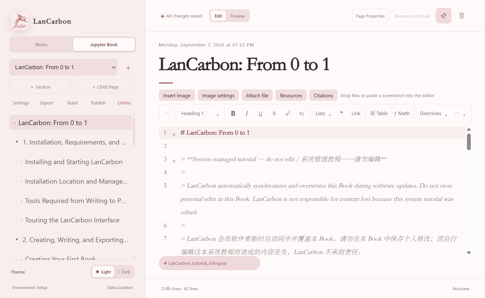

<p align="center"></p>
<h1 align="center">LanCarbon</h1>
<p align="center">An offline desktop application for writing Notes, creating structured Books, building Jupyter Book websites, and publishing them to GitHub Pages.</p>
<p align="center"><a href="https://github.com/Hao-jieDai/LanCarbon/releases/latest"><strong>Download the latest release</strong></a> · <a href="#english">English</a> · <a href="#中文">中文</a></p>



<a id="english"></a>

## English

### What is LanCarbon?

LanCarbon is a Windows desktop application for writing ordinary Markdown Notes and organizing longer work as Books with Sections and Child Pages. It keeps writing and managed resources on your computer. An account is not required for ordinary writing, and LanCarbon sends content only when you explicitly use Publish or make AI requests.

Version 2.4.1 adds independent Embedding and optional Rerank settings, bounded local vector caching, hybrid retrieval and retrieval-purpose usage accounting. Chat and translation connections can be reused without changing their saved model lists.

**PDF layout fix:** Fit width and Fit page now recalculate when the window or reading sidebar changes size, keeping the selected reading mode.

**Important publishing fix:** LanCarbon now preserves the system tutorial's GitHub repository binding when synchronizing official tutorial content. Earlier builds could show the repository as connected in the interface while the publishing backend had already lost that connection, preventing Publish from continuing. If an earlier build has already removed the binding, reconnect the existing repository once after upgrading; subsequent tutorial synchronization will retain it.

**Resource-dialog fix:** Duplicate images and attachments now use an in-app choice dialog instead of a Windows message box, restoring focus after closing to address the reported disappearing mouse after duplicate-resource warnings.

### Main features

- Offline Markdown Notes with search, tags, pinning and autosave. **Sort by** orders Notes and the Book selector by **Last modified**, **Date created** (newest first) or **Name (A–Z)**; pinned Notes stay first and the two workspaces remember their choices independently. A Book's last-modified time includes edits to its pages.
- Structured Books with Sections, Child Pages, page properties and Book settings. Click a page's triangle to expand or collapse its children; folds are saved separately for each Book. Navigating to a page or creating a child reveals its ancestors. Sorting the Book selector never reorders the Book's contents or exports.
- **Notes / Books** workspace tabs with an embedded **Q** hint in the Books tab and a **Ctrl+Q** hover tooltip, preserving your selected Note or Book page when switching. The shortcut is inactive while a dialog is open; Jupyter Book 2 remains the Build tool's name.
- CodeMirror editing, an expanded Math symbol panel, MyST-aware formatting tools and an offline Preview with **Ctrl+E** view switching.
- Images, attachments, reusable Resources, BibTeX libraries and citations.
- Optional export of a separate Jupyter Book source copy.
- Export the current Note or Markdown Book page as an A4 PDF with its title, text, math, managed images, tables and page numbers. Only the selected page is included, not its children or the entire Book.
- Managed local website builds with preflight checks and restart recovery.
- GitHub repository connection, GitHub Pages publishing and later website updates.
- Environment Setup with managed, independently repairable tools and folder-permission recovery under the LanCarbon root.
- Light and Dark themes with the LanCarbon visual style.

**AI refinements:** Cross-model history now carries source attribution and current-model identity instructions; shared editable response guidelines request professional replies without emoji. Chat uses its conversation title, saved keys have masked previews and a direct removal action, and transient rate-limit/server errors receive at most two cancellable retries before any output. Existing keys, chats and personal writing are retained. Persistent upstream limits still require the provider to recover.

### AI Settings and Chat

1. Open **Workshop → AI Settings** and choose **SiliconFlow**, **OpenRouter** or **Others**. Presets supply their base addresses. Others supports OpenAI-compatible Chat Completions services and additional named configurations.
2. Paste the service's **API Key** and select **Refresh models**, or enter an exact **Model ID** and **Display name**, then **Add model → Save models**. Choose a **Default model**. Use the platform catalogue for current model IDs and account permissions.
3. Saved keys appear as **Configured**, showing their first four and last four characters with the middle hidden. Leave the key input blank to retain it, or enter a replacement and save. **Remove saved key** asks for confirmation and removes only the local key, preserving models and chats. Revoke the key separately at the service when required.
4. Expand **Response guidelines · all chat models** to edit the shared **System prompt**, then select **Save guidelines**. **Restore default guidelines** fills the default; save to apply it. Defaults request professional, accurate, calm, neutral and concise responses, without emoji or decorative language, and distinguish facts from interpretation and uncertainty. These instructions apply to future replies across all services; they do not rewrite history or guarantee identical model quality.
5. **Test model** saves the connection and makes a small request. **Stop test** cancels a running test. Connections follow the computer's network and system proxy; normal service charges apply.
6. In **Chat**, select **service · model** and send text. **Enter** sends; **Shift+Enter** inserts a line break. Use **Stop generating**, **Retry reply** and **Copy**. Markdown, code and mathematics are rendered; provided reasoning is folded separately. The heading shows the actual conversation title.
7. Use **New chat**, **Rename chat** and **Delete chat** to manage local conversations. Switching models retains relevant context, but earlier replies from other models are explicitly attributed reference material. The current model is asked to answer independently, using its configured model ID for identity questions. Similar answers alone do not establish which model was used; check each reply's recorded service/model. When the same question is repeated after switching models, earlier answers to that exact question from other models are omitted from the request and retained locally. For a comparison without any prior context, start a separate chat.

SiliconFlow uses base address `https://api.siliconflow.cn/v1`; OpenRouter uses `https://openrouter.ai/api/v1`. Use **Refresh models** or your platform's catalogue for current IDs. The OpenRouter model `meta-llama/llama-4-maverick` can be added manually when available to your account.

Keys remain encrypted for the current Windows account in **Config/ai-settings.json**; only masked previews reach the interface. Moving to another Windows account may require re-entry. Back up the complete LanCarbon home folder, including Config, Cache and Library, together with any separately selected Data location. Conversations are local in **Data/Research/Chats/chats.json**. Switching to Notes or Books lets generation continue; closing LanCarbon stops it and preserves partial replies. Chat submits your conversation text and response guidelines; Notes, Books and Library files are not automatically attached. PDF and EPUB reading are available in Library; retrieval and literature workflows follow separately.

### Retrieval models

Open **Workshop → AI Settings → Retrieval**. Embedding and optional Rerank have separate service/model choices. **Use an existing connection** reuses a saved Chat or translation key without changing its Chat model list. **Separate retrieval connection** stores an independent encrypted key; choose SiliconFlow, OpenRouter or Others. Others accepts an HTTPS API base address and exact model ID. Embedding requires a compatible **/embeddings** endpoint with float vectors; Rerank requires **/rerank** with indexed relevance scores. A service may offer only one of these endpoints. Model IDs and account permissions must match the service.

1. Select an Embedding service and model, enable **Enable semantic retrieval**, and save. SiliconFlow model examples are **BAAI/bge-m3** and **Pro/BAAI/bge-m3**. Consult your service's current catalogue for availability and prices. The suggestions are not an account-access check.
2. Optionally enable **Use reranking**, select its connection and model, and save. SiliconFlow examples are **BAAI/bge-reranker-v2-m3** and **Pro/BAAI/bge-reranker-v2-m3**. Embedding and Rerank may use the same connection or different services/keys. Removing an independent key affects the retrieval roles sharing that connection and preserves Chat settings.
3. **Test Embedding** sends a built-in English sentence and checks vector dimensions. **Test Rerank** sends a built-in question and two short examples. Both use normal service billing and are recorded under their corresponding Usage purposes. **Stop** cancels a test or active retrieval task. Saving alone makes no model request.
4. In **Workshop → Usage → Model prices**, configure each retrieval model's input price per million tokens and set output to zero. For a model currently offered free, set both to zero. Provider-reported token counts and charges are used when available; missing usage remains unknown. Failed attempts and retries remain recorded. Reusing a connection automatically uses its existing billing account; independent retrieval connections can be grouped with Chat/translation in **Connections sharing this balance**. Keep a paid account tracked when only some of its models are free.

**Index tools** is an optional advanced panel. It prepares vectors only for current, successfully extracted Knowledge base sources. Unchanged passage text is reused; changed/deleted or deselected sources are excluded from retrieval. A changed Embedding service/model has a separate vector space and needs preparation again. Local keyword ranking and semantic ranking are combined; optional Rerank orders the candidate passages. Retrieval check displays source passages and positions without generating a Chat answer. If semantic retrieval or reranking fails, the panel explicitly identifies the fallback and any incomplete preparation.

Preparing sources sends their extracted text to the selected Embedding service. A search sends the question to Embedding and selected candidate passages to Rerank when enabled. Ordinary writing and local keyword search with semantic retrieval off make no retrieval requests. Retrieval follows the computer's network and system proxy. Query instructions are normally blank; Qwen3 Embedding receives its standard retrieval query instruction automatically, and document text is not prefixed.

Vectors use a bounded **128 MB** local cache in **Data/Research/Retrieval**, with up to 40,000 passages and 8,192 dimensions. No local model files are downloaded. **Clear vector index** removes vectors while keeping original files and extracted text; preparing again may incur service charges. Clearing the text index also clears its vector cache. Completed batches survive stop/restart; an interrupted task is resumed explicitly with Prepare. Data Location carries the derived cache. Chat answers with source citations are a separate feature.

### Knowledge base

Open **Workshop → Knowledge base** to prepare a local text index. In **Library**, **Notes** or **Books**, select individual sources, an entire Book, or a Library Imports folder. A Book includes its pages; an included folder also includes files added later in its subfolders. **Include linked attachments** follows the selected writing's resources and indexes a shared file once. System content, including this tutorial and ReadMe, is excluded unless **Include system content** is enabled. Name, location and tag search helps choose sources.

Select **Build index** to save the selection and start processing. **Update index** applies later selection changes and retries failed sources; unchanged content is reused. **Keep selected sources up to date** refreshes changed writing and registered file versions while LanCarbon runs, and after its next launch. Rename/move retains source identity. Removed or deselected sources leave the index; outdated text is withheld until refreshed. Turn off automatic updates for manual control. **Stop** retains completed work and pauses processing; Update index resumes it.

**Ready** means extracted text is available; **Partial** explains incomplete coverage. **Failed**, **Missing** and **Unsupported** identify sources needing attention without stopping other sources. **Preview** displays extracted passages with PDF page numbers, EPUB chapter/paragraph positions, or Markdown headings/lines. Source links reopen the original file or writing. **Search extracted text** finds words and phrases present in the index; it does not generate answers or perform semantic retrieval.

Text extraction supports Note/Book Markdown pages, text-based PDFs and reflowable EPUBs. Images, Word and other formats are listed but are not parsed. Image-only scans need OCR; encrypted PDFs and DRM/fixed-layout EPUBs cannot be indexed. Limits are 500 PDF pages, 3,000 EPUB chapters and 2 million text characters per source, 2,000 passages per source, and 100 MB of stored text. Partial status reports the actual coverage. Complex layouts and tables may need checking in Preview.

**Rebuild index** recreates derived text for the current selection. **Clear index** removes only derived text, pauses indexing and keeps your selection; Library originals, personal Notes/Books, chats and usage remain. The index and selection live in **Data/Research/Knowledge**, follow Data Location and can be rebuilt. Parsing and keyword search stay on this computer, do not send content to AI services and incur no API fees. Semantic retrieval is configured in AI Settings → Retrieval; document-grounded Chat is separate.

### Library imports

1. Open **Library → Imports**, choose a destination folder and use **Import PDF / EPUB** or drop local documents into the main area. Each batch accepts 20 files, 100 MB each. **New folder** creates an Imports subfolder; the sidebar shows the hierarchy. **All files** and filename search show file locations. Source materials remains the managed writing-resource collection.

Select an Imports folder to use **Rename folder** or **Delete folder**. Deleting a folder moves its files and subfolders to the parent, numbers conflicting names, and retains document IDs, writing links and versions. It does not delete the contents. Changes made in File Explorer within Imports are checked on startup, when returning to Library, and every few seconds: folder and document renames/moves retain identity where the original can be identified; new PDF/EPUB files are indexed locally. Deleted documents remain marked missing so references are preserved. Use **Open externally** to edit file contents with version history; directly overwriting managed originals is reported and requires restoration or re-import.
2. Duplicate checks use exact file contents across Library and its retained versions. Import details shows the incoming filename, existing/current name, location and matching version. Importing a.pdf, renaming it b.pdf, then importing the same a.pdf reuses b.pdf and retains its name. Re-importing an old revision does not roll back the current one. **Locate** opens the existing entry; **Move to…** can move an imported original into the chosen folder.
3. Equal names with different contents receive numbered names in the same folder; the report shows the final name. Different folders can contain equal names. Renaming checks names in the same folder, ignores case and preserves extensions; conflicts show a suggested available name without overwriting or merging. **Move** preserves the document ID, writing links and versions; conflicts require **Keep both as…** or Cancel.
4. **Open** or double-click reads PDFs in LanCarbon; **Open externally** uses the default app. Images, TXT, Word and other ordinary resources use the default app. Executables, scripts and shortcuts are excluded. The app opens a named working copy under **Library/.Editing**; saving that file registers a new current version within a few seconds while LanCarbon runs, or after its next launch. Unchanged saves add no version. **Versions** lists revisions and **Save version** exports an earlier one; old versions remain stored locally. Saving as another file/location requires a separate import. Keep managed hash-named originals intact; use Open for editing.
5. Notes and Books **Attach file** starts in root **Library**. Selecting an imported original reuses it with its current display name and a stable writing reference, without copying its bytes into assets. Later rename/move/version changes keep the reference valid and use the current contents. Removing this linked resource in Resources removes its writing references while the Library original remains in Imports. Ordinary resource deletion still removes its files and versions after confirmation.
6. **Folder** reveals the managed original and **Save a copy** exports outside Library. Importing itself is offline and inserts no writing link. Catalogs and edit-session records live in the active **Data/Library**; originals, retained versions and working copies stay in root **Library**. Moving Data carries the records. Back up both locations, including pending working copies. After using folders, linked attachments or new versions, application rollback needs a matching data snapshot; preserve newer writing separately before restoring it.

**Batch operations:** Select **Batch select** to show file checkboxes and the batch toolbar; the normal list keeps both hidden. Use the checkboxes or **Select visible** to select files in the current list or search results. **Exit selection** clears the checkmarks and returns to the normal list. The toolbar shows the count and offers **Clear selection**, **Move selected**, **Export selected** and **Delete selected**. Changing a folder or filter clears the selection. Built-in tutorial resources are protected and excluded from selection. Move applies to imported originals and keeps IDs, versions, references and reading positions; choose an Imports destination and whether to **Keep both when names match**. Export copies current versions into a chosen folder outside Library, numbering matching names without overwriting. Originals stay unchanged; per-file failures are listed and successful items are retained.

**Delete** on a row or **Delete selected** permanently removes the selected managed files and their stored versions, including missing entries. Confirmation lists all affected Note/Book references; confirming removes those links and resource settings while retaining surrounding writing. Shared files needed by unselected resources are kept. Open tabs close and external-edit tracking stops. Cancel leaves files and references untouched. Deleting an imported original in Library also removes its linked writing resource; deleting only that link in Resources continues to keep the Imports original. To remove a file completely, use Library deletion rather than deleting it in File Explorer.

### Reading PDFs

Open a PDF from Library with **Open** or a double-click. In a Note or Book, click its attachment in **Preview**, or use **Resources → Read PDF**. **Workspace** in the tab bar returns to the original writing or Library view. **Open externally** retains default-app editing and file versions; Other ordinary files use their default apps.

Use page numbers, previous/next, **Fit width**, **Fit page**, zoom, or **Pages / Contents** for on-demand thumbnails and the document's own outline. **Find in PDF** (Ctrl+F) searches the document with previous/next matches. Reading position and zoom are saved by document ID in **Data/Library/reading.json**, so rename/move and linked writing attachments share progress. The currently open PDF is an immutable reading snapshot; a new externally saved version offers **Reload latest version**.

Enable the existing **Translate** switch (Ctrl+Alt+T), then select short English text in the PDF. Existing translation settings, cache and usage accounting apply. PDFs need a selectable text layer for selection/search; image-only scans remain viewable. Reading is local and does not call AI or change the file. Password-protected files prompt locally without saving the password. PDF scripts and editing are disabled. Annotation creation and OCR follow separately. The reader loads page data as needed and releases the open snapshot when closed; no PDF parsing or thumbnail disk cache is created.

Use **Collapse sidebar** beside the Logo to hide the workspace sidebar. The menu button at the upper left of the content shows it again. Notes, Books, Workshop, Library and PDF reading share this control; the desktop collapse preference is remembered across restarts. On narrow windows the sidebar opens as a drawer.

The reader uses two toolbar rows: file tabs and the sidebar toggle at the top, followed by reading controls. **Open externally** is beside the search box. The file name appears in its tab; **Workspace** returns to the previous writing or Library view while keeping file tabs open. When files are open, the sidebar toggle stays at the left of the tab row, including when the tabs are scrolled.

### EPUB reading and file tabs

Open an EPUB in Library with **Open** or a double-click, or open its attachment from Note/Book **Preview** or **Resources → Read EPUB**. The reader uses local EPUB 2/3 chapters and navigation, with selectable text, embedded images and tables. **Contents** jumps to chapters or headings; previous/next buttons switch chapters. **Find in EPUB** (Ctrl+F) searches the book and lists up to 250 matches. Font size, line spacing and reading width are adjustable. Reading follows LanCarbon's theme and common text layout; publisher-specific styles, scripts, audio/video, external resources, DRM and fixed-layout publications are not supported. Unsupported books can use **Open externally**.

Enable **Translate** (Ctrl+Alt+T) to translate selected English using the existing translation configuration and Usage records. Reading itself is offline and does not call AI. Chapter, scroll position and typography are saved by stable document ID in **Data/Library/epub-reading.json**, shared by Library and linked Note/Book attachments. Rename/move and restart preserve progress. A newer external version offers **Reload latest version**. The file remains unchanged; no extracted-book cache is written to disk.

PDFs and EPUBs share a top tab bar with up to **10 files**. Opening the same document from another location activates its existing tab. Select a tab to return to its saved position; the active tab scrolls into view. **Workspace** returns to writing or Library without closing the tabs. The **×** on a tab closes only that file; closing the active tab selects a neighboring one. At the limit, close a tab before opening another. Arrow keys, Home and End switch tabs when a tab has keyboard focus. Tabs and the active file are restored after restart; only the active document body is loaded.

### Estimated API balances

At the top of **Workshop → Usage**, use **Set balance / Update balance** to name a billing account and select **Connections sharing this balance**. Select only connections billed to the same account: different chat and dedicated translation API keys may share one account, while separate accounts on the same platform should stay independent. Each connection belongs to at most one account. Enter the full current balance in CNY or USD; never add existing card balances together. Only fees recorded after calibration are deducted across the selected connections, models, chat, tests and translation. Pending requests count when their fees arrive. Reported charges take priority over request-time price estimates; unknown fees stay unknown. Update balance prefills the current estimated remaining balance. Keep the amount unchanged when only renaming the account; saving preserves the original calibration and any fees completed while editing. Edit the amount to calibrate a new platform balance. After changing shared connections, explicitly enter the full current balance again to confirm the new checkpoint.

Choose **Unlimited · No balance tracking** for a free service or an account that needs no balance reminders. No amount is required; token and cost statistics continue unchanged. For tracked balances, reminders appear strictly below **CNY 5** or **USD 2**, based on currency rather than interface language. After a top-up or regrouping, enter the full current account balance to start a new checkpoint. Other accounts that lose connections need recalibration; unchecked connections become separate entries. Historical usage and fees are never moved, deleted or charged again. **Stop tracking** clears the checkpoint while preserving shared membership and usage. Cards are independent of Usage filters. Existing separate balances are retained until you explicitly regroup them. Records live in **Data/Research/Usage/balances.json** and travel with Data Location. Other apps' charges or platform credits require manual recalibration; no balance API is called. Cross-currency deductions use the exchange rate saved in Model prices.

### Selection translation

1. Open **Workshop → Translation Settings**. With **Use an existing AI connection**, select a service and a model already saved in AI Settings. The saved key and model display name are reused; this mode has no model catalogue refresh or editable model fields. To add a dedicated translation service/model, choose **Separate translation connection**, configure SiliconFlow, OpenRouter or Others, then use **Refresh translation models** or enter its exact Model ID and display name. Refresh reads a platform catalogue; account access and pricing still need checking.
2. **Save translation settings**, then **Test translation**. The result beside the buttons shows **Translation test succeeded**, the selected service/model, the fixed English sentence **Climate change affects investment.**, and its Chinese translation. **Stop translation test** cancels a running test. Testing makes a real request even with automatic translation off. The editable **Translation prompt** applies only to translation; model format adaptation is automatic. The default asks for accurate academic Chinese without explanations or emoji. English within this prompt field can also be selected for translation without changing its contents.
3. Translation starts **off** each time LanCarbon opens. Enable the sidebar **Translate** switch or press **Ctrl+Alt+T**. Select an English word, phrase or short passage in Notes/Books **Edit** or **Preview**, Workshop, Library or selectable interface text. After selection settles, the floating panel shows the selected English and Chinese translation. Drag its header to move it; the position is remembered. Long source and translated text scroll independently inside the compact panel. Close the panel or use the switch/shortcut to disable automatic requests. Passwords, API keys and connection addresses are excluded.
4. Select at most **1,600 characters / 250 words**. Only the selection and translation instructions are sent, without the whole Note, Book or Chat. New selections cancel earlier translation requests. Cancellation cannot undo charges already incurred upstream.
5. Repeated selections with the same saved service/model/prompt reuse local results without another API call. **Saved translations → Clear translation cache** clears only the translation cache, limited to **1,000 results / 5 MB**, stored under **Data/Research/Translation**. Translation and manual tests appear in **Usage → Purpose: Translation**; locally reused results do not add tokens or requests. Configure the translation model's price in **Model prices** when the service does not report costs. Dedicated keys have masked previews and **Remove translation key**; blank key inputs retain the saved key.

### Token usage and costs

Open **Workshop → Usage**. The default is **Today**; choose **Last 7 days**, **Last 30 days**, or custom **From / To** dates. Source, model and purpose filters apply to the entire range. The compact overview shows **Requests**, total **Tokens** and **Costs**, with each title and value on one line. Requests are newest first, ten per page; pagination does not change totals or activity.

**Token activity** has its own dates, independently of the summary/request filters above. **Hourly** defaults to today and shows 24 square cells centered in three rows of eight (00–07, 08–15, 16–23); choose another day using its calendar. **Daily** defaults to the current full year, with 365/366 cells arranged by week and labeled by month; select a different year independently. Changing From / To or Today / Last 7 days / Last 30 days changes summaries and request records without switching activity mode or dates. Source, model and purpose filters apply to both. From, To and the hourly day use the LanCarbon-themed calendar; dates can also be typed as YYYY-MM-DD. Darker cells mean more tokens. Hover or focus for time/date, tokens and CNY cost; missing data stays unknown.

In **Model prices**, choose a configured model and save its input/output rates per million tokens and original currency. Optional cache rates use the input rate when blank; enter zero for a verified free model. Saved prices can be edited. Removing a model and saving its configuration, deleting a service, or changing its API address automatically removes obsolete prices. Historical requests retain their own price snapshots and original reported charges.

Set **1 USD = CNY → Save exchange rate** to choose a local display reference (default 7, not a live quote). USD fees are converted and combined with CNY fees for display; changing this rate updates historical CNY display values without changing original charges. Hover a cost for its original currency and Reported/Estimated source. Reported costs come from the API; estimates use the price saved when the request started. The platform statement remains authoritative.

Viewing Usage works offline and does not call a model. Local logs are in **Data/Research/Usage**, prices and exchange rate in **Config/ai-pricing.json**. Logs contain no keys or conversation bodies; model/chat deletion does not erase history. Use **Purpose: Translation** for selection translation and its tests; locally reused translations do not create requests. Only recorded LanCarbon calls are included, without backfilling older chats or other apps.

### Workspaces and recovery

The four workspace buttons form a 2×2 grid: **Notes / Books** above **Workshop / Library**. Each retains its selection when switching and restarting. Workshop contains **Run**, **Templates**, **Outputs**, **Chat**, **Usage**, **AI Settings** and **Translation Settings**; pages labeled **Coming soon** have no active AI or literature actions yet. Library uses a compact file list. Selecting a file keeps its references in a fixed panel above the independently scrolling list; **Save a copy** sits beside its filename. Select a reference to open its Note or Book page and highlight the cited line, or open the corresponding Book settings/Citations panel. **Folder** reveals the actual file and **Rename** changes its display and saved-copy name while retaining IDs, extensions and existing writing. Built-in tutorial resources cannot be renamed; **Open Library folder** opens the originals folder. Existing resources retain their IDs, locations and Markdown links.

**Ctrl+Q** switches Notes and Books; from Workshop or Library it returns to the most recently used writing workspace. **Ctrl+N** and **Ctrl+E** operate only in Notes and Books.

Managed writing resources are stored in root **Library/assets**. Existing Data/assets is copied and verified before retirement; file IDs, bytes, catalog records and writing links are retained. Newly attached, pasted or dropped files use Library/assets. The resource catalog **assets.json** remains in the active Data folder. Original files have a dedicated root **Library/Imports** and **Library/AI-Paper**. Management data lives under the active **Data/Library**; templates, drafts, records and chats have separate folders under **Data/Research**. Moving Data includes these management folders and assets.json; root Library and its resource files stay with the installation. Notes and Books retain Workspace v2, and unsupported workspace versions are blocked without modifying their files.

Before upgrading, close LanCarbon and back up the complete LanCarbon home folder and any separately selected Data location. Include Cache because its encryption state is needed to read previously saved API keys. Keep the stable installer alongside the backup. Reinstalling an older application may also require restoring matching data. A restored snapshot returns to the backup date; retain later edits separately. Developers can use the verified snapshot commands below. Restore accepts a new empty folder, verifies all files before copying and adjusts saved managed paths to that folder.

```powershell
node scripts/workspace-recovery.cjs backup --root "D:\LanCarbon" --destination "D:\Backups\LanCarbon-snapshot" --installer "release/LanCarbon-2.4.1-x64-Setup.exe"
node scripts/workspace-recovery.cjs verify --backup "D:\Backups\LanCarbon-snapshot"
node scripts/workspace-recovery.cjs restore --backup "D:\Backups\LanCarbon-snapshot" --target "D:\Recovered\LanCarbon"
```

### Export a page as PDF

Select **Export PDF** in the page header from Edit or Preview, choose a filename and destination (default: the page title), and save. The default PDF destination is the **PDFs** folder beside Exports under the LanCarbon root. Installation or startup creates it automatically; you can still choose another destination. Exports remains for Book source copies, and existing PDFs are not moved. Export saves the latest edits first and needs no optional tools. It uses a white reading layout without editor controls or line numbers. Book home pages, Sections and Child Pages are exported individually. Links to omitted Book pages and attachments remain readable labels, not embedded content. Preview limitations also apply to PDF; check export notices and inspect the result. Existing PDFs require overwrite confirmation; canceling or a failed export leaves the previous file intact. The sidebar **Export** still creates the entire Book source copy.

### Download and install

Open [Releases](https://github.com/Hao-jieDai/LanCarbon/releases) and download `LanCarbon-2.4.1-x64-Setup.exe`. Ordinary users should download the installer, rather than GitHub's automatically generated source-code archives.

The installer supports 64-bit Windows. Its default root is `D:\LanCarbon`. You may choose another location, but a first-install destination must be an empty folder named `LanCarbon`. The installer creates:

```text
LanCarbon/
├─ Application/   Program files
├─ Data/          Notes, Books and resource records
├─ Config/        Application and Book preferences
├─ Cache/         Re-creatable runtime cache
├─ Temp/          Temporary build and publishing files
├─ Builds/        Saved local websites
├─ Exports/       Default starting location for Book source-copy Export
├─ PDFs/          Default destination for page PDFs
├─ Library/      assets: writing resources; Imports / AI-Paper: source materials / 原始资料
└─ Tools/         Optional tools managed by Environment Setup
```

If the computer has no D drive, the installer uses a `LanCarbon` folder in the current Windows user's directory. Windows itself may still use system folders briefly for installer extraction, shortcuts, registry records and operating-system caches.

### Additional tools

Basic writing, Preview, PDF export and source-copy Export work inside LanCarbon. Additional tools are required only for the corresponding workflow:

- **Build:** Python 3, Node.js and Jupyter Book 2.
- **Publish:** Git, GitHub CLI, a GitHub account and network access to GitHub.

LanCarbon checks these requirements in **Environment Setup**, introduced by the first-run ReadMe and available from the sidebar and from the Build and Publish panels. Compatible system installations are marked **Using existing** and do not show an install action. Missing or incompatible tools can be installed as private managed copies under `LanCarbon/Tools`; installing Jupyter Book also prepares missing managed Python and Node.js dependencies. The Python action uses a portable archive and never changes a registered system Python. Downloads show live byte and percentage progress, are verified before deployment, and can be canceled with partial files removed. Windows file-lock failures are retried with increasing waits. Environment Setup checks whether `Tools` is writable and offers **Repair folder permissions**—with a Windows approval prompt when elevation is required—if its access rules block managed installation. Failed downloads or repairs do not affect Notes, Books or tools already installed successfully. The system-managed tutorial retains its GitHub publishing connection when official tutorial content is refreshed, so its connected repository remains available for later updates.

If GitHub cannot be reached, enable the proxy application's system proxy or TUN mode and retry. The bundled *LanCarbon: From 0 to 1* Book explains managed and manual installation, writing, Build, GitHub sign-in, publication and common errors.

### Privacy and local data

LanCarbon stores the active workspace in the selected `Data` folder. It does not require a LanCarbon account or synchronize Notes automatically. Back up the whole LanCarbon root before moving to another computer or making major system changes.

### Development

Development requires Node.js 22.12 or newer. Jupyter Book 2 is also required for the complete build and end-to-end test suite.

```bash
npm install
npm run dev
```

Development defaults to `.dev-workspace/LanCarbon` inside this checkout. Set `LANCARBON_ROOT` only when deliberately choosing another isolated root.

Installed-workspace verification accepts an optional report directory: `node scripts/verify-acceptance-workspace.cjs ROOT BACKUP VERSION REPORT_DIRECTORY`. Choose a report folder inside the checkout when verifying a daily installation.

开发启动默认使用当前项目中的 `.dev-workspace/LanCarbon`，与日常安装隔离；仅在明确指定另一处独立目录时设置 `LANCARBON_ROOT`。

已安装工作区验证可通过 `node scripts/verify-acceptance-workspace.cjs ROOT BACKUP VERSION REPORT_DIRECTORY` 指定报告目录。验证日常安装时，请将报告保存到项目内的独立目录。

```bash
npm run typecheck
npm test
npm run build
npm run test:e2e
npm run dist
```

The Windows installer is written to `release/`. Generated dependencies, builds, installers, caches and test output are excluded from Git.

### Support

Use [GitHub Issues](https://github.com/Hao-jieDai/LanCarbon/issues) to report reproducible problems or suggest improvements. Do not include passwords, GitHub tokens, private Book content or personal data in an issue.

---

<a id="中文"></a>

## 中文

### LanCarbon 是什么？

LanCarbon 是一款 Windows 桌面写作软件，既可以撰写普通 Markdown Notes，也可以通过 Sections 和 Child Pages 组织较长的 Books。正文和受管理资源保存在你的电脑上。普通写作不需要账号，只有在你明确使用 Publish 时，LanCarbon 才会上传内容。

2.4.1 增加独立的 Embedding 与可选 Rerank 配置、有容量限制的本地向量缓存、混合检索及按检索用途统计的用量。可复用 Chat 或翻译连接，不改变其保存的模型列表。

**PDF 排版修复：** 调整窗口大小或展开阅读侧栏后，Fit width 和 Fit page 会自动重新计算，保留所选阅读方式。

**重要发布修复：** LanCarbon 现在会在同步官方教程内容时保留系统教程的 GitHub 仓库绑定。旧版本可能出现界面显示仓库已经连接，但发布后台已经丢失连接，导致 Publish 无法继续的问题。如果旧版本已经清除了绑定，请在升级后重新连接一次现有仓库；此后的教程同步会保留该连接。

**资源提示修复：** 图片或附件重名时改用软件内选择对话框，关闭后恢复焦点，以处理重复资源提示后鼠标消失的问题。

### 检索模型

打开 **Workshop → AI Settings → Retrieval**。Embedding 和可选的 Rerank 分别选择服务与模型。**Use an existing connection** 复用已保存的 Chat 或翻译密钥，不修改 Chat 模型列表；**Separate retrieval connection** 保存独立的加密密钥，可选 SiliconFlow、OpenRouter 或 Others。Others 填入 HTTPS API 基础地址及准确模型 ID。Embedding 需要兼容 **/embeddings** 的浮点向量接口；Rerank 需要兼容 **/rerank**、返回输入序号及相关分数的接口。同一服务可能只支持其中一种接口，模型 ID 和账号权限须以平台为准。

1. 选择 Embedding 服务和模型，勾选 **Enable semantic retrieval** 并保存。SiliconFlow 模型示例为 **BAAI/bge-m3**、**Pro/BAAI/bge-m3**；可用性和价格请查平台当前目录，软件建议列表不代表账号一定有调用权限。
2. 按需勾选 **Use reranking**，选择其连接和模型并保存。SiliconFlow 示例为 **BAAI/bge-reranker-v2-m3**、**Pro/BAAI/bge-reranker-v2-m3**。两类模型可共用连接，也可使用不同服务或密钥。删除独立密钥只影响共用该连接的检索角色，保留 Chat 配置。
3. **Test Embedding** 发送一条内置英文句子并检查向量维度；**Test Rerank** 发送内置问题和两条短例文。测试按平台规则计费，分别记入对应的 Usage 用途；**Stop** 可取消测试或正在执行的检索任务。仅保存设置不会请求模型。
4. 在 **Workshop → Usage → Model prices** 设置每个检索模型每百万输入 tokens 的价格，输出价格设为零。平台当前免费的模型将输入和输出均设为零。优先使用平台返回的 tokens 和费用，缺失用量保留为未知；失败尝试和重试照实记录。复用连接自动沿用原余额账户；独立检索连接可在 **Connections sharing this balance** 与 Chat／翻译归入同一计费账户。仅部分模型免费时，保留付费账户的余额跟踪。

**Index tools** 是可选的高级工具，仅为 Knowledge base 中当前选定且已成功提取的文本准备向量。未变化片段直接复用；修改、删除或取消选取的资料退出检索。更换 Embedding 服务或模型后使用独立向量空间，需要重新准备。系统结合本地关键词排名和语义排名，并可用 Rerank 重排候选片段。Retrieval check 展示资料片段及位置，不生成 Chat 回答；语义检索、重排失败或资料尚未准备完整时会明确提示降级情况。

准备资料会将提取的正文发送给所选 Embedding 服务；检索将问题发送给 Embedding，启用 Rerank 时再发送候选片段。普通写作及关闭语义检索后的本地关键词搜索不调用检索 API；网络沿用电脑的网络与系统代理。Query instructions 通常留空，Qwen3 Embedding 自动使用标准检索问题指令，不给资料正文添加指令前缀。

向量缓存保存在 **Data/Research/Retrieval**，上限 **128 MB**，最多 40,000 个片段及 8,192 维，不下载本地模型。**Clear vector index** 仅删除向量，保留原文件及提取文本；重新准备可能再次计费。清除文本索引也会清除对应向量缓存。暂停和重启保留已完成批次，中断任务用 Prepare 明确继续；Data Location 会携带缓存。带来源引用的 Chat 问答是另一项功能。

### 知识库

打开 **Workshop → Knowledge base** 准备本地文本索引。在 **Library**、**Notes** 或 **Books** 中选择单项资料、整本 Book 或 Library Imports 文件夹。整本 Book 包含其页面；纳入的文件夹也包含子文件夹内以后加入的文件。**Include linked attachments** 纳入所选写作引用的资源，共用文件只索引一次。内置教程、ReadMe 等系统内容默认排除，启用 **Include system content** 后才可纳入。可以按名称、位置和标签搜索资料。

点击 **Build index** 保存范围并开始处理。之后用 **Update index** 应用范围调整并重试失败资料，未改变的内容直接复用。**Keep selected sources up to date** 会在软件运行及下次启动后更新已保存的写作内容和已登记的文件新版本；改名、移动保留资料身份。被删除或取消选择的资料退出索引；更新完成前不提供过期文本。关闭自动更新后可手动控制。**Stop** 保留已完成结果并暂停，Update index 继续处理。

**Ready** 表示文本可用，**Partial** 说明实际覆盖范围。**Failed**、**Missing** 和 **Unsupported** 分别提示失败、缺失和不支持的资料，不中断其他资料。**Preview** 展示文本片段及 PDF 页码、EPUB 章节／段落位置、Markdown 标题／行号；来源链接可打开原文件或写作页面。**Search extracted text** 查找索引中实际存在的词句，不生成回答，也不进行语义检索。

支持 Note／Book 的 Markdown 页面、带文本层的 PDF 和流式 EPUB。图片、Word 等其他格式会列出，但不解析；纯扫描版需要 OCR，密码保护的 PDF 以及 DRM／固定版式 EPUB 暂不能建立索引。每份资料最多处理 500 页 PDF、3,000 个 EPUB 章节、200 万个文本字符和 2,000 个片段，总文本存储上限 100 MB。达到限制会标为 Partial 并说明覆盖情况，复杂排版和表格请通过 Preview 核对。

**Rebuild index** 根据当前范围重建文本，**Clear index** 仅清除派生文本、暂停索引并保留范围，不删除 Library 原件、个人 Notes／Books、聊天或用量。索引和范围在 **Data/Research/Knowledge**，随 Data Location 迁移，可重新生成。解析和关键词搜索都在本机进行，不向 AI 服务发送资料，不产生 API 费用；语义检索在 AI Settings → Retrieval 配置，基于资料的 Chat 是另一项功能。

### 主要功能

- 支持搜索、标签、置顶和自动保存的离线 Markdown Notes。通过 **Sort by** 将 Notes 列表或 Book 下拉框按 **Last modified**（修改时间）、**Date created**（创建时间，时间均为最新在前）或 **Name (A–Z)**（名称）排序；置顶 Notes 始终优先，两个工作区分别记住排序选择。Book 修改时间也会计入其页面正文的修改。
- 使用 Sections、Child Pages、Page Properties 和 Book Settings 组织 Books。点击页面前的三角形展开或折叠子页面，每本 Book 分别保存折叠状态；跳转到页面或新建子页面时会自动展开上级目录。Book 下拉框的排序不会改变 Book 内部目录和导出顺序。
- 工作区统一显示为 **Notes / Books**，Books 按钮内部右侧显示 **Q** 提示，悬停可查看 **Ctrl+Q** 快捷键；切换时保留原来选中的 Note 或 Book 页面，对话框打开时不触发快捷键。Build 工具名称仍为 Jupyter Book 2。
- CodeMirror 编辑器、扩充后的 Math 符号面板、MyST 格式工具，以及支持 **Ctrl+E** 切换的离线 Preview。
- 图片、附件、可重复使用的 Resources、BibTeX 文献库和 Citations。
- 按需导出独立的 Jupyter Book 源文件副本。
- 将当前 Note 或 Markdown Book 页面导出为 A4 PDF，保留标题、文字、公式、受管理图片、表格和页码；只包含当前页面，不包含子页面或整本 Book。
- 带预检和重启恢复的本地网站 Build。
- 连接 GitHub 仓库、发布到 GitHub Pages，并在以后更新网站。
- Environment Setup 可在 LanCarbon 根目录中独立安装和修复所需工具，并恢复 Tools 文件夹权限。
- 具有 LanCarbon 视觉风格的 Light 和 Dark 主题。

**AI 功能修正：** 跨模型历史标注来源并明确当前模型身份；可编辑共用回答规范默认要求专业表达、不使用 emoji。聊天顶部直接显示会话标题；密钥提供掩码与直接删除入口；输出开始前的临时限流或服务错误最多进行两次可取消重试。已有密钥、会话和个人写作保留，持续的上游限流仍需平台恢复。

### AI Settings 与 Chat

1. 打开 **Workshop → AI Settings**，选择 **SiliconFlow**、**OpenRouter** 或 **Others**。前两项预填 API 地址；Others 支持兼容 OpenAI Chat Completions 的服务，也可添加多个命名配置。
2. 填入服务的 **API Key** 后点击 **Refresh models**，或填写准确的 **Model ID** 与 **Display name**，点击 **Add model → Save models**，并选择 **Default model**。通过平台目录确认当前模型 ID 与账号调用权限。
3. 已保存密钥显示 **Configured**，仅展示前四位和后四位，中间隐藏。密钥输入栏留空保留原密钥，填写新密钥并保存可替换。**Remove saved key** 经确认后仅清除本地保存的密钥，保留模型配置与会话；需要撤销平台上的密钥时另到平台操作。
4. 展开 **Response guidelines · all chat models**，编辑共用的 **System prompt**，点击 **Save guidelines** 保存。**Restore default guidelines** 填入默认内容，保存后生效。默认要求专业准确、冷静中立、简洁高效，不使用 emoji 或装饰性表达，区分事实、解释与不确定性。规范用于各服务后续回复，不改写旧记录，也不保证不同模型质量相同。
5. **Test model** 保存配置并发送小型请求，运行期间可以 **Stop test**。连接跟随电脑网络与系统代理，可能产生平台正常费用。
6. 在 **Chat** 中选择 **服务 · 模型** 并发送文字。**Enter** 发送，**Shift+Enter** 换行。使用 **Stop generating**、**Retry reply** 与 **Copy**；支持 Markdown、代码和公式，提供的推理文字单独折叠。顶部直接显示会话标题。
7. **New chat**、**Rename chat** 和 **Delete chat** 管理本地会话。切换模型保留相关上下文，但其他模型的旧回答会标注来源，作为参考资料传递。当前模型按自己的配置 ID 回答身份问题，并独立分析新问题。回答相似不能单独证明调用了哪个模型，应查看回复记录的服务和模型；切换模型后重复同一问题时，不向新模型发送其他模型对这道题的旧答案，旧记录仍保留在本地；需要完全独立的上下文时另建会话。

SiliconFlow 地址为 `https://api.siliconflow.cn/v1`，OpenRouter 地址为 `https://openrouter.ai/api/v1`。通过 **Refresh models** 或平台目录获取当前准确 ID；账号可用时可以手动添加 OpenRouter 模型 `meta-llama/llama-4-maverick`。

密钥仍使用当前 Windows 账户加密，保存在 **Config/ai-settings.json**，界面只接收掩码。迁移 Windows 账户后可能需要重填；备份时保留完整 LanCarbon 文件夹（包括 Config、Cache 和 Library），另选的数据目录也需同时备份。会话位于 **Data/Research/Chats/chats.json**；切到 Notes 或 Books 后生成继续，关闭软件会停止生成并保存已有回复。Chat 提交会话文字与回答规范，Notes、Books 和 Library 文件不会自动附加。PDF 和 EPUB 可在 Library 内阅读；检索与文献工作流另行提供。

### Library 资料导入

1. 打开 **Library → Imports**，选择目标文件夹后 **Import PDF / EPUB** 或拖入本地文档。每批最多 20 个、每个 100 MB。**New folder** 创建 Imports 子文件夹，左侧显示目录树。**All files** 与文件名搜索显示所属位置；Source materials 仍用于受管理的写作资源。

选中 Imports 子文件夹后，使用 **Rename folder** 或 **Delete folder**。删除文件夹会把文件和子目录移到上一级，重名自动编号，保留文档 ID、写作引用与历史版本，不删除内容。在文件资源管理器中修改 Imports 后，软件会在启动、返回 Library 及运行期间每隔几秒检查：能够识别原件的文件夹或文档改名、移动会保持身份，新放入的 PDF／EPUB 会自动登记。被删除的文档保留记录并标为缺失，以保留引用。修改文件内容请使用 **Open externally** 以保留版本历史；直接覆盖受管理原件会提示异常，需要恢复或重新导入。
2. 在整个 Library 及保留版本中按文件字节去重。Import details 显示导入名称、已有文件当前名称、位置和匹配版本。导入 a.pdf、改名 b.pdf 后，再导入相同 a.pdf，会复用 b.pdf 并保留改名。重新导入旧版本不会回退当前版本。**Locate** 定位原条目；**Move to…** 可将导入原件移动到所选文件夹。
3. 同文件夹内同名不同内容自动编号，报告显示最终名称；不同文件夹允许同名。重命名只检查同文件夹名称，忽略大小写并保留扩展名，冲突时提示可用名称，不覆盖或合并。**Move** 保留文档 ID、引用与全部版本；移动重名时明确选择 **Keep both as…** 或取消。
4. **Open** 或双击在 LanCarbon 阅读 PDF，**Open externally** 使用默认程序；图片、TXT、Word 等普通资料使用默认程序，程序、脚本和快捷方式不直接打开。软件打开 **Library/.Editing** 中带名称的编辑副本；保存该文件后，LanCarbon 运行时会在几秒内登记新版本，关闭期间的保存会在下次启动后处理。内容未变不新增版本。**Versions** 查看历史，**Save version** 导出旧版本；历史原件保留在本地。另存其他文件或位置需另行导入。请保持带哈希的受管理原件完整，通过 Open 进行编辑。
5. Notes 和 Books 的 **Attach file** 默认打开根目录 **Library**。选择导入原件时沿用当前显示名与稳定写作引用，不再把原件复制到 assets。之后改名、移动或产生新版本，引用保持有效并读取当前内容。在 Resources 删除此类关联资源时移除写作引用，原件仍在 Imports；普通资源删除仍会在确认后删除文件和历史版本。
6. **Folder** 定位受管理原件，**Save a copy** 将副本导出到 Library 之外。导入本身可离线完成，不自动插入写作链接。目录及编辑会话记录在实际 **Data/Library**，原件、历史版本和编辑副本在根目录 **Library**；更改 Data 携带记录。两处都需备份，包括尚未登记的编辑副本。使用子目录、关联附件或新版本后，回滚程序需要匹配的数据快照；恢复前另行保留新增写作内容。

**批量操作：** 点击 **Batch select** 后才显示文件复选框和批量操作栏，普通列表默认隐藏。通过复选框或 **Select visible** 选取当前列表或搜索结果中的文件。点击 **Exit selection** 清空勾选并恢复普通列表。操作栏显示数量，并提供 **Clear selection**、**Move selected**、**Export selected** 和 **Delete selected**。切换文件夹或筛选会清空勾选；内置教程资源受到保护，不参与选取。移动仅适用于导入原件，保留 ID、版本、引用和阅读进度；选择 Imports 目标文件夹，并决定是否 **Keep both when names match**。导出将当前版本复制到 Library 之外的目标文件夹，重名自动编号，不覆盖已有内容，原件保持不变。逐项列出失败原因，成功结果保留。

文件行的 **Delete** 或 **Delete selected** 会永久删除选中的受管理文件及其历史版本，也可清理缺失条目。确认框列出全部 Note／Book 引用；确认后移除对应链接和资源设置，保留周围正文。其他未选资源仍需使用的共享文件会保留。相关阅读标签关闭，外部编辑跟踪停止；取消不改变文件和引用。在 Library 删除导入原件，也会移除关联的写作资源；仅在 Resources 删除关联资源，仍保留 Imports 原件。需要完整删除文件时，请使用 Library 删除功能，不要直接在文件资源管理器中删除。

### PDF 阅读

在 Library 中点击 **Open** 或双击 PDF。在 Note／Book 的 **Preview** 点击 PDF 附件，或通过 **Resources → Read PDF** 打开；标签栏的 **Workspace** 返回原来的写作或文件列表。**Open externally** 保留默认程序编辑和文件版本功能，其他普通文件继续使用默认程序。

使用页码、前后翻页、**Fit width**、**Fit page**、缩放，以及 **Pages / Contents** 中按需生成的缩略图和原文目录。**Find in PDF**（Ctrl+F）提供全文搜索与前后匹配。阅读位置和缩放按文档 ID 保存在 **Data/Library/reading.json**；改名、移动及写作附件共用进度。正在阅读的内容保持为打开时的版本，外部保存新版后，可选择 **Reload latest version**。

开启现有 **Translate**（Ctrl+Alt+T），选取 PDF 中的短英文即可翻译，沿用翻译配置、缓存和用量统计。选词与搜索需要 PDF 自带文字层；纯扫描件仍可查看。阅读本身离线运行，不调用 AI、不修改原件。加密文件在本地输入密码，密码不保存；禁用 PDF 脚本和编辑。新建批注与 OCR 另行提供。页面按需读取，关闭后释放打开快照，不建立 PDF 解析或缩略图磁盘缓存。

点击 Logo 旁的 **Collapse sidebar** 可收起工作区侧栏，点击内容区左上角的菜单按钮再次展开。Notes、Books、Workshop、Library 与 PDF 阅读共用此操作，桌面侧栏状态在重启后保留；窄窗口使用抽屉式侧栏。

阅读区使用两行工具栏：上方为文件标签和侧栏开关，下方为阅读操作；**Open externally** 位于搜索框左侧。文件名只在标签中显示，点击 **Workspace** 返回先前的写作或 Library 页面并保留文件标签。打开文件后，侧栏开关固定在标签行左侧，横向滚动标签时仍可操作。

### EPUB 阅读与文件标签

在 Library 中点击 **Open** 或双击 EPUB，或从 Note／Book 的 **Preview** 附件和 **Resources → Read EPUB** 打开。阅读器在本地读取 EPUB 2／3 的章节和目录，支持选取文字、内嵌图片与表格。**Contents** 跳转章节或标题，前后按钮切换章节；**Find in EPUB**（Ctrl+F）搜索全书并列出最多 250 条匹配。可调整字号、行距和阅读宽度。正文采用 LanCarbon 主题和统一文字排版；不支持出版物专用样式、脚本、音视频、外部资源、DRM 和固定版式书籍。无法内置阅读的书籍可使用 **Open externally**。

开启 **Translate**（Ctrl+Alt+T）后，选取英文即可沿用翻译配置与 Usage 统计。阅读本身离线运行，不调用 AI。章节、滚动位置和文字样式按稳定文档 ID 保存在 **Data/Library/epub-reading.json**，Library 与 Note／Book 的关联附件共用；改名、移动或重启后保留进度。外部保存新版后提供 **Reload latest version**。阅读不修改原件，不在磁盘建立解压后的书籍缓存。

PDF 与 EPUB 共用顶部标签栏，最多同时打开 **10 个文件**。从不同位置打开同一文献会切换到已有标签；切换后恢复各自位置，当前标签会自动滚动到可见处。**Workspace** 返回写作／Library，同时保留文件标签；标签上的 **×** 只关闭该文件，关闭当前标签后切换到相邻文件。达到上限后需先关闭一个标签。标签获得键盘焦点时，可用方向键、Home、End 切换。重启后恢复标签和当前文件，正文只加载当前文件。

### API 估算余额

在 **Workshop → Usage** 顶部，通过 **Set balance / Update balance** 命名计费账户，在 **Connections sharing this balance** 勾选共用余额的连接。只合并实际从同一账户扣费的连接：聊天与独立翻译可使用不同 API Key；同平台的不同账户应保持独立。每个连接最多属于一个余额账户。输入 CNY 或 USD 的完整当前余额，不能把已有卡片的余额相加。保存后只扣减此后记录到的费用，汇总所选连接的所有模型、聊天、测试和翻译；尚未完成的请求在费用结算后计入。优先使用接口返回费用，否则采用请求时的价格快照；未知费用保持未知。Update balance 默认填入当前估算剩余余额。只修改账户名称时无需重填金额；保存会保留原校准起点，也保留编辑期间结算的费用。修改金额用于校准平台新余额；调整共享连接后，需明确重新输入完整当前余额以确认新起点。

免费服务或不需要余额提醒的账户可选择 **Unlimited · No balance tracking**，无需填写额度，Token 与费用统计照常保留。追踪余额时，严格低于 **人民币 5 元**或 **2 美元**才提醒，按币种而非界面语言判断。充值或调整共享连接后重新输入完整当前余额，建立新的扣费起点；其他失去连接的账户需重新校准，取消勾选的连接独立显示。历史用量和费用不转移、不删除，也不重新扣减。**Stop tracking** 只清除余额起点，保留共享关系和用量。卡片独立于 Usage 筛选；现有独立余额会保留，直到你主动合并。记录位于 **Data/Research/Usage/balances.json**，随 Data Location 迁移；其他软件消费或平台赠额需手动校准，不调用平台余额接口。跨币种扣减沿用 Model prices 中的手动汇率。

### 选词翻译

1. 打开 **Workshop → Translation Settings**。选择 **Use an existing AI connection** 时，仅选择服务与 AI Settings 已保存的模型，密钥和显示名称沿用原配置；该模式不提供目录刷新或模型字段编辑。新增独立的翻译服务／模型时，选择 **Separate translation connection** 配置 SiliconFlow、OpenRouter 或 Others，再 **Refresh translation models** 或手填准确的 Model ID 与显示名称。刷新读取平台目录，可调用权限与价格仍需核对。
2. **Save translation settings → Test translation**。按钮附近的结果明确展示 **Translation test succeeded**、服务／模型、固定原句 **Climate change affects investment.** 与中文译文。**Stop translation test** 取消正在进行的测试；自动翻译关闭时也可手动测试，会产生真实请求。可编辑的 **Translation prompt** 仅用于翻译，所需模型格式自动适配；默认要求准确、专业、只输出简体中文且不用 emoji。提示词输入框中的英文也可选取翻译，原内容不受修改。
3. 每次启动默认**关闭**。点击侧栏 **Translate** 或按 **Ctrl+Alt+T** 开启后，在 Notes／Books 的 **Edit** 或 **Preview**、Workshop、Library 及可选取的界面文字中选择英文单词、词组或短句。选取稳定后浮窗显示原文与中文；原文与长译文分别在内部滚动，保持窗口紧凑。拖动标题栏可移动并记住位置。关闭浮窗或使用开关／快捷键停止自动调用。密码、API Key 与接口地址不参与翻译。
4. 单次最多 **1,600 字符／250 词**，仅发送选取内容与翻译要求，不附带整篇 Note、Book 或聊天。新的选取取消旧翻译请求；取消不能撤销上游已经发生的费用。
5. 相同来源、模型、提示词的重复选取复用本地结果，不再次请求 API。**Saved translations → Clear translation cache** 仅清除翻译缓存，位于 **Data/Research/Translation**，上限 **1,000 条／5 MB**。翻译及手动测试在 **Usage → Purpose: Translation** 中统计；本地复用不增加请求与 Token。服务不返回费用时，在 **Model prices** 配置翻译模型价格。独立密钥显示掩码，可用 **Remove translation key** 清除本地保存；输入框留空保留原密钥。

### Token 用量与费用

打开 **Workshop → Usage**，默认查看 **Today**；可选 **Last 7 days**、**Last 30 days**，或自选 **From / To** 日期。来源、模型和用途筛选作用于整个区间。紧凑概览只显示 **Requests**、总 **Tokens** 和 **Costs**，标题与数字在同一行。请求按最新在前排列，每页十条；翻页不影响汇总和活动热力图。

**Token activity** 使用独立日期，不跟随上方汇总／请求筛选。**Hourly** 默认今天，24 个正方形格子按三行八列居中排列（00–07、08–15、16–23），可用自己的日历切换日期。**Daily** 默认当前完整年份，365／366 格按周排列、标记月份，可独立切换年份。修改 From／To 或 Today／Last 7 days／Last 30 days 只调整汇总和请求记录，不切换热力图模式或日期；来源、模型和用途筛选同时作用于两者。From、To 与小时日期使用 LanCarbon 风格日历，也可手填 YYYY-MM-DD。颜色越深表示 Token 越多；悬浮或聚焦查看时间／日期、总 Token 和人民币费用，缺失数据仍为未知。

在 **Model prices** 选择已配置模型，保存每百万 Token 的输入／输出单价及原始币种。缓存价格留空按输入价；经平台确认的免费模型可填零。已保存价格可编辑。删除模型并保存配置、删除服务或更改 API 地址时，自动清理对应的旧价格；历史请求保留当时单价及平台返回的原币费用，不受清理影响。

通过 **1 USD = CNY → Save exchange rate** 设置本地换算参考值（默认 7，不是实时汇率）。美元费用折算后与人民币费用合计显示；修改汇率会更新历史记录的人民币显示值，但不改变原币费用。悬浮费用可查看原币金额以及 Reported／Estimated 来源。Reported 来自接口，Estimated 按请求开始时的单价估算，最终以平台账单为准。

查看 Usage 支持离线，不额外调用模型。日志位于 **Data/Research/Usage**，单价和汇率位于 **Config/ai-pricing.json**。日志不包含密钥或对话正文；删除模型或聊天不删除历史。通过 **Purpose: Translation** 查看选词翻译及其测试，本地复用不产生请求。仅统计 LanCarbon 已记录的调用，不补算旧聊天或其他软件消耗。

### 工作区与恢复

四个工作区入口按 2×2 排列：上行为 **Notes / Books**，下行为 **Workshop / Library**，切换和重启后保留各自选择。Workshop 包含 **Run**、**Templates**、**Outputs**、**Chat**、**Usage**、**AI Settings** 和 **Translation Settings**；标记为 **Coming soon** 的页面尚未启用 AI 或文献处理。Library 使用紧凑列表，选择文件后引用面板固定在独立滚动列表上方，**Save a copy** 位于文件名旁。点击引用可打开对应 Note 或 Book 页面并选中引用行，或进入对应 Book Settings/Citations。**Folder** 定位实际文件，**Rename** 修改显示与副本保存名称，保留 ID、扩展名和原有正文；系统教程资源不提供重命名；**Open Library folder** 打开原始资料文件夹。旧资源保留原有 ID、位置和 Markdown 引用。

**Ctrl+Q** 在 Notes 与 Books 之间切换；在 Workshop 或 Library 中按下时返回最近使用的写作工作区。**Ctrl+N** 与 **Ctrl+E** 仅在 Notes 和 Books 中生效。

受管理写作资源统一保存在根目录 **Library/assets**；旧 Data/assets 先复制校验再迁出，保留文件 ID、字节、管理记录及正文链接。新附件、粘贴图片和拖入文件也使用 Library/assets。资源目录记录 **assets.json** 继续保存在实际 Data 中。原始文件目录为根目录下的 **Library/Imports** 和 **Library/AI-Paper**；管理数据位于实际数据目录中的 **Data/Library**。模板、生成稿、记录和聊天分别位于 **Data/Research** 下。更换 Data 位置会一并复制这些管理目录和 assets.json，根目录 Library 及其原始资源仍随安装位置保存。Notes 和 Books 沿用 Workspace v2，不支持的数据版本会停止加载，保留原文件。

升级前请关闭 LanCarbon，备份实际数据位置、Config、Library，以及需要保留的 Builds、Exports 和 PDFs，并保存稳定版安装包。恢复旧程序时可能还需要恢复匹配的数据；恢复快照会回到备份时的状态，后续新增编辑应另行保留。开发者可使用英文对应章节的备份、校验和恢复命令。恢复只接受新的空目录，复制前验证全部文件，并将受管理路径调整为恢复目录。

### 导出页面为 PDF

在 Edit 或 Preview 中点击页面顶部的 **Export PDF**，选择文件名和保存位置（默认为页面标题），然后保存。PDF 默认保存位置为 LanCarbon 根目录下与 Exports 同级的 **PDFs** 文件夹，安装或启动时会自动创建；仍可自行选择其他保存位置。Exports 继续用于 Book 源文件副本，已有 PDF 不会自动搬移。导出前会先保存最新修改，不需要额外工具。PDF 使用白底阅读排版，不包含编辑工具栏和行号。Book 首页、Section 和 Child Page 均可单独导出。指向未导出 Book 页面的链接和附件保留为可读文字，不会嵌入目标内容。Preview 的支持范围同样适用于 PDF，请检查导出后的注意事项和生成结果。覆盖已有 PDF 需要确认；取消或导出失败不会破坏原有文件。侧边栏的 **Export** 仍用于导出整本 Book 的源文件副本。

### 下载与安装

打开 [Releases](https://github.com/Hao-jieDai/LanCarbon/releases)，下载 `LanCarbon-2.4.1-x64-Setup.exe`。普通用户应下载安装程序，不要下载 GitHub 自动生成的 Source code 压缩包。

安装程序支持 64 位 Windows，默认根目录为 `D:\LanCarbon`。你也可以选择其他位置，但首次安装的目标必须是一个名为 `LanCarbon` 的空文件夹。安装后自动建立：

```text
LanCarbon/
├─ Application/   程序文件
├─ Data/          Notes、Books 和资源管理记录
├─ Config/        软件与 Book 设置
├─ Cache/         可以重新生成的运行缓存
├─ Temp/          构建和发布临时文件
├─ Builds/        保存的本地网站
├─ Exports/       Book 源文件副本 Export 默认起始位置
├─ PDFs/          页面 PDF 默认保存位置
├─ Library/      assets: writing resources; Imports / AI-Paper: source materials / 原始资料
└─ Tools/         Environment Setup 管理的可选工具
```

如果电脑没有 D 盘，安装器会使用当前 Windows 用户目录中的 `LanCarbon` 文件夹。Windows 仍可能短暂使用系统目录完成安装器解压、快捷方式、注册信息和操作系统缓存。

### 额外工具

普通写作、Preview、PDF 导出和源文件副本 Export 可以直接在 LanCarbon 中完成。只有相应流程需要以下工具：

- **Build：** Python 3、Node.js 和 Jupyter Book 2。
- **Publish：** Git、GitHub CLI、GitHub 账号，以及能够访问 GitHub 的网络。

LanCarbon 会在统一的 **Environment Setup** 中检查这些条件；首次启动的 ReadMe 会介绍该页面，可以从侧边栏、Build 和 Publish 面板进入。系统中已有的兼容工具只显示 **Using existing**，不再提供安装操作；缺失或不兼容的工具可作为私有副本安装到 `LanCarbon/Tools`，安装 Jupyter Book 时也会自动准备缺失的受管理 Python 和 Node.js。Python 使用便携压缩包，不会修改已注册的系统 Python。下载过程显示实时字节数和百分比，校验、部署与复检阶段均清楚可见，取消后会清理未完成文件。Windows 文件占用错误会按逐渐增长的等待时间自动重试；Environment Setup 还会检查 `Tools` 是否可写，并在权限阻止安装时提供 **Repair folder permissions**，需要管理员权限时显示 Windows 确认窗口。下载或修复失败不会影响 Notes、Books 或此前成功安装的工具。系统管理教程在刷新官方内容时会保留 GitHub 发布连接，因此已经连接的仓库仍可用于后续更新。

如果无法访问 GitHub，请先开启代理软件的系统代理或 TUN 模式再重试。内置的 *LanCarbon: From 0 to 1* 教程详细讲解受管理安装、手动安装、写作、本地 Build、GitHub 登录、发布和常见错误。

### 隐私与本地数据

LanCarbon 将当前工作区保存在选定的 `Data` 文件夹中。它不要求注册 LanCarbon 账号，也不会自动同步 Notes。迁移到其他电脑或进行较大的系统修改前，请备份整个 LanCarbon 根目录。

### 开发

开发需要 Node.js 22.12 或更高版本。运行完整构建和端到端测试还需要 Jupyter Book 2。

```bash
npm install
npm run dev
```

```bash
npm run typecheck
npm test
npm run build
npm run test:e2e
npm run dist
```

Windows 安装包输出到 `release/`。依赖、构建结果、安装包、缓存和测试输出均不会进入 Git 仓库。

### 问题反馈

可以通过 [GitHub Issues](https://github.com/Hao-jieDai/LanCarbon/issues) 报告能够复现的问题或提出改进建议。请勿在 Issue 中公开密码、GitHub Token、私人 Book 内容或个人数据。

## License

LanCarbon is released under the [MIT License](LICENSE).
