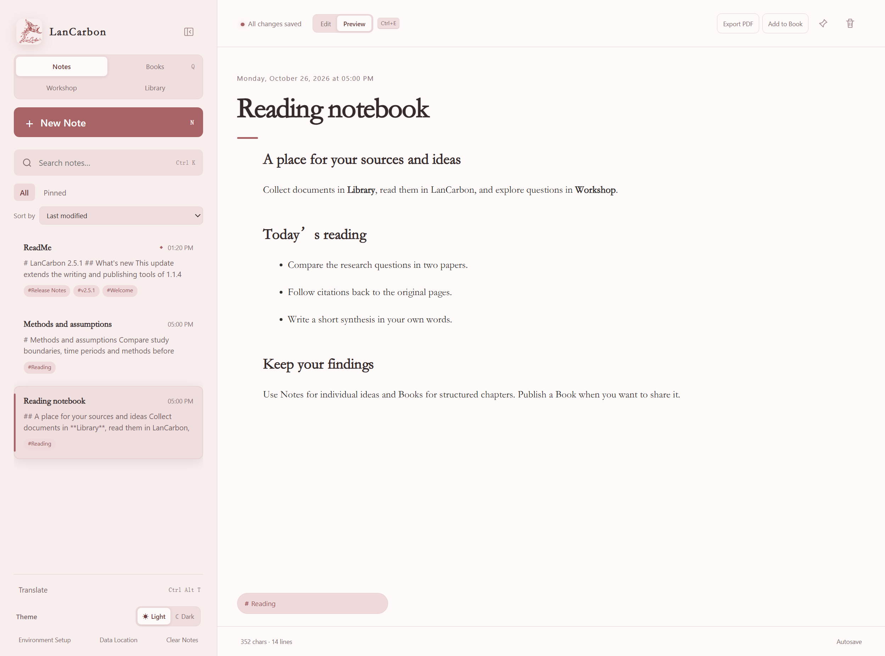

<p align="center"></p>
<h1 align="center">LanCarbon</h1>
<p align="center">Read, ask, write and publish — build a personal knowledge library.</p>
<p align="center"><a href="https://github.com/Hao-jieDai/LanCarbon/releases/latest"><strong>Download the latest release</strong></a> · <a href="#english">English</a> · <a href="#中文">中文</a></p>



<a id="english"></a>

## English

### What is LanCarbon?

LanCarbon is a Windows desktop application that combines local writing and document reading with AI assistance. Keep original material in **Library**, explore it in **Workshop**, write your own **Notes**, and organize longer work as **Books**. Books can also become local websites or be published to GitHub Pages.

### What's new in 2.5.1

This update brings the writing and publishing tools of 1.1.4 together with document management, reading and knowledge-library questions.

- **Library:** import PDF/EPUB documents, organize folders, handle duplicates, keep file versions and manage writing attachments. Rename, move and inspect references; use batch selection to move, export or delete files.
- **Built-in reading:** read PDF and EPUB inside LanCarbon, use document outlines and search, keep reading positions and switch between up to ten open documents. Local English/Chinese OCR makes scanned PDF pages selectable and searchable.
- **Workshop and AI Chat:** configure SiliconFlow, OpenRouter, DeepSeek or other compatible services and choose saved models for conversations. Set shared response guidelines, view available Thinking, and export conversations to PDF or editable Notes.
- **Selection translation:** translate English words, phrases and short passages while writing or reading. Reuse a saved model or configure an independent translation connection; enable translation only when needed.
- **Knowledge-library questions:** choose Library documents, Notes and Book pages as sources, ask follow-up questions or compare documents, then follow citations back to the original. Current full-text questions use the selected Chat model without requiring Embedding or Rerank setup.
- **Usage and costs:** review tokens, request history and activity heatmaps; configure model prices, a reference exchange rate and estimated account balances. Group connections that share the same billed account.
- **A reorganized tutorial:** *LanCarbon: From 0 to 1* provides separate Library and Workshop chapters, current screenshots, and consistent instructions for writing, publishing, reading and knowledge-library work.

Notes, Books, existing model settings and chat history are retained on upgrade. Automated paper discovery and collection expansion are not available yet. Document questions support reading and comparison; check important figures, formulas and interpretations against the linked originals before using them in research.

### Download and get started

Download **LanCarbon-2.5.1-x64-Setup.exe** from its Release when available. Until this update is published, the latest-release link points to the currently published version. GitHub's Source code archives are for developers, not the Windows installer.

The installer is not digitally signed; Windows may show an Unknown publisher or SmartScreen notice. Close LanCarbon before upgrading; the installer reuses the existing installation location. Keep a data backup and a working installer for recovery.

Open **Books → LanCarbon: From 0 to 1** for the bilingual tutorial. For reading, start with Library and then Workshop. For writing and publication, follow the installation, authoring, Build and Publish chapters. The tutorial is system-managed: updates replace its contents. Create your own Notes and Books for personal work.

### Local work, AI and publishing

Writing, document management, reading and OCR work locally. AI requests require your own configured service and network access; normal service fees apply. Chat sends conversation text and selected source material; translation sends selected text. Ordinary writing does not automatically upload your library. API keys are encrypted for the current Windows account.

Usage and balances are local records and estimates, not a synchronized provider bill. Check the service's account page for actual credit and charges. Back up the complete LanCarbon home, including Config, Library and encryption state in Cache, plus any separate Data Location. Changing Windows accounts may require re-entering API keys.

Building and publishing a Book are optional. **Environment Setup** guides you through Python, Node.js and Jupyter Book for Build, and Git and GitHub CLI for Publish. You do not need these website tools simply to write notes, read PDFs or use configured AI services.

### Development and feedback

```bash
npm ci
npm run dev
npm run typecheck
npm test
```

The app uses Electron, React and TypeScript. For the installed full-text question workflow, read [the RAG maintenance guide](docs/rag-update-guide.md) before making changes. `npm run setup:paperqa` prepares its development runtime; `npm run dev:paperqa` uses that workflow. `npm run dist` builds a Windows installer with the required reading and PaperQA resources.

Report reproducible problems through [GitHub Issues](https://github.com/Hao-jieDai/LanCarbon/issues), with the application version and steps to reproduce. Remove API keys, personal documents and private conversations from reports.

---

<a id="中文"></a>

## 中文

### LanCarbon 是什么？

LanCarbon 是一款将本地写作、文档阅读与 AI 辅助结合起来的 Windows 桌面软件。用 **Library** 保存原始资料，在 **Workshop** 中理解和处理内容，用 **Notes** 记录自己的想法，再通过 **Books** 组织长期写作。Book 也可以构建成本地网站或发布到 GitHub Pages。

### 2.5.1 的主要更新

本次更新在 1.1.4 的写作与发布功能基础上，加入资料管理、文档阅读和个人知识库问答。

- **Library 资料管理：**导入 PDF／EPUB、组织文件夹、处理重复文件、保存版本并管理写作附件。支持改名、移动、查看引用，以及批量移动、导出和删除。
- **内置阅读：**直接阅读 PDF 和 EPUB，使用目录与搜索，保留阅读进度，最多切换十个打开的文档。本地中英文 OCR 让扫描 PDF 的文字可以选取和搜索。
- **Workshop 与 AI Chat：**配置 SiliconFlow、OpenRouter、DeepSeek 或其他兼容服务，为对话选择已保存的模型。支持共用回答规范、查看模型返回的 Thinking，以及导出 PDF 或可编辑 Note。
- **划词翻译：**在写作和阅读时翻译英文单词、词组或短段落。可以复用已有模型或独立配置翻译连接，按需开启。
- **个人知识库问答：**选择 Library 文档、Notes 和 Book 页面作为来源，继续追问或比较多份文档，并通过引用返回原文。当前全文问答使用选定的 Chat 模型，不要求先配置 Embedding 或 Rerank。
- **用量与费用：**查看 Token、请求历史和活动热力图，设置模型价格、参考汇率和估算账户余额。实际共用一个计费账户的连接可以合并统计余额。
- **重新组织的教程：***LanCarbon: From 0 to 1* 分设 Library 和 Workshop 章节，更新截图，并以统一的写法介绍写作、发布、阅读与知识库操作。

升级保留 Notes、Books、已有模型配置和聊天记录。自动文献发现与资料库自动拓展尚未开放。资料问答用于辅助阅读和比较；用于研究前，请通过原文核对重要数字、公式与解释。

### 下载与开始使用

本版本发布后，请从对应 Release 下载 **LanCarbon-2.5.1-x64-Setup.exe**。发布前，最新版本链接仍指向当前已公开版本。GitHub 的 Source code 压缩包面向开发者，不是 Windows 安装程序。

安装包尚未进行数字签名，Windows 可能显示“未知发布者”或 SmartScreen 提醒。升级前关闭 LanCarbon；安装程序沿用原有安装位置。请保留数据备份和可用安装包以便恢复。

打开 **Books → LanCarbon: From 0 to 1** 阅读双语教程。资料阅读从 Library 和 Workshop 开始；写作与发布按照安装、写作、Build、Publish 相关章节学习。教程由系统管理，升级会覆盖其内容；个人内容请放在自己创建的 Notes 和 Books 中。

### 本地使用、AI 与在线发布

写作、文件管理、阅读和 OCR 在本地完成。AI 请求需要你自行配置服务并能够通过网络访问它，费用按服务商规则计算。Chat 发送对话和选定来源，翻译发送选中文字；普通写作不会自动上传整个资料库。API Key 按当前 Windows 账户加密。

用量和余额是本地记录及估算，不是平台账单的同步副本；真实额度和费用请查看服务商账户页面。备份应包含整个 LanCarbon 主目录，包括 Config、Library、Cache 中的加密状态，以及另行设置的 Data Location。更换 Windows 账户后可能需要重新输入 API Key。

Book 构建与发布是可选功能。**Environment Setup** 引导安装配套工具：Build 使用 Python、Node.js 和 Jupyter Book，Publish 使用 Git 与 GitHub CLI。单纯写笔记、阅读 PDF 或使用已配置的 AI 服务，无需先安装网站构建工具。

### 开发与反馈

```bash
npm ci
npm run dev
npm run typecheck
npm test
```

软件使用 Electron、React 和 TypeScript。修改安装版全文问答流程前，请先阅读 [RAG 维护指南](docs/rag-update-guide.md)。`npm run setup:paperqa` 准备相应开发运行环境，`npm run dev:paperqa` 使用该流程。`npm run dist` 构建包含阅读及 PaperQA 资源的 Windows 安装包。

请通过 [GitHub Issues](https://github.com/Hao-jieDai/LanCarbon/issues)反馈可复现的问题，说明软件版本和复现步骤。请勿提交 API Key、个人文档或私人聊天。

## License

MIT — see [LICENSE](LICENSE).
